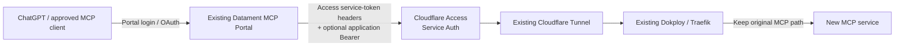
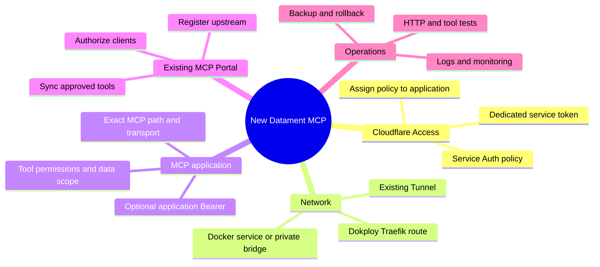
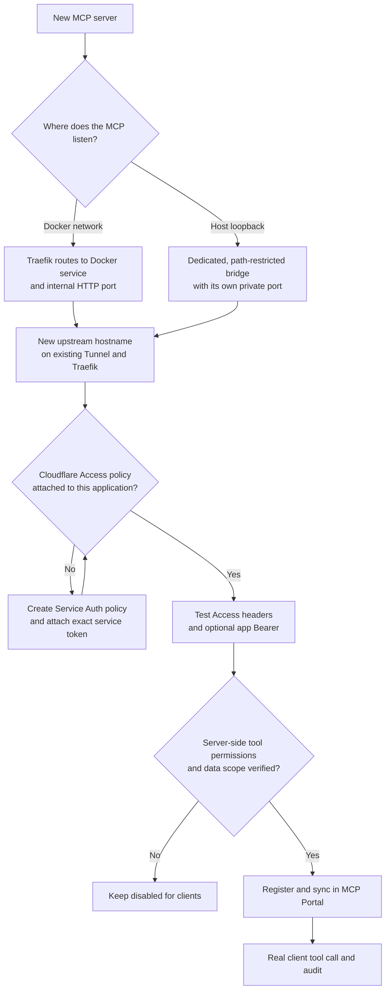
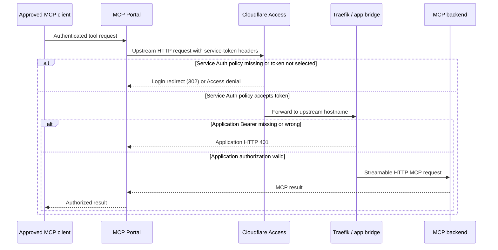

## Scope

Use this page when an MCP server is already deployed on the Datament server with Dokploy and you need to make it usable from ChatGPT. It covers Traefik, Cloudflare Tunnel, Cloudflare Access and the Cloudflare MCP Portal.

This is the standard operator runbook for onboarding **future MCP servers** to the existing Datament infrastructure. The generic examples are placeholders; the table and worked MemPalace example below record actual verified settings. Verified Graphify details are on [Graphify reference](/mcp/graphify-reference), MemPalace-specific settings are on [MemPalace reference](/mcp/mempalace-reference), and dated changes are on [Changelog](/mcp/changelog).

<Warning>
  Rules that apply to every step:

  - Do not replay these steps against a server that already works. Implement only the missing layers.
  - Do not replace existing production routes with the examples.
  - Do not broaden project approvals as part of connecting a client.
  - Keep every secret out of Git, URLs and logs. This page says where secrets are stored, never their values.
</Warning>

## Terms

| Term | Meaning on this page |
| --- | --- |
| Upstream | Your MCP server, reached at its own Access-protected hostname |
| Portal | The Cloudflare MCP Portal that ChatGPT connects to. Cloudflare hosts it |
| Connector | The `cloudflared` process on your server that links the tunnel to Cloudflare |
| Cloudflare Gateway routing | An optional Cloudflare traffic-inspection feature. It is not the Graphify gateway service |

Request path:

```text
ChatGPT -> Cloudflare MCP Portal -> Access-protected upstream -> Cloudflare Tunnel -> Traefik -> MCP container
```

The upstream and portal hostnames have different roles. Do not route the portal hostname back to your MCP container.

## Visual walkthrough

The diagrams below show **how a new MCP is added without replacing the existing Datament portal, tunnel or Traefik installation**. They are editable Mermaid diagrams rendered directly by Mintlify; the specific onboarding fields and commands remain in the numbered procedure that follows.

### Architecture: request path and trust boundaries



The **portal hostname** (`mcp-server.datament.sk`) belongs to Cloudflare's managed portal and is not another Traefik upstream. The **upstream hostname** (for example `example.datament.sk`) resolves through the existing tunnel. The portal's user login, Cloudflare Access Service Auth and the MCP application's own authentication are separate controls.

### Mind map: what each new MCP needs



### Decision diagram: Docker or host-loopback MCP?



### Authentication sequence: why the policy assignment matters



<Note>
  The successful MemPalace public initialization test returned HTTP 200 after both the Cloudflare Service Auth policy and the application's Bearer token were correct. A successful initialization does not prove that remote write operations are blocked; test permissions separately before enabling client access.
</Note>

## Standard Datament onboarding: exact operator sequence

Use this **token-first workflow** for each new MCP server. The later numbered sections are implementation references for Docker, Traefik, Cloudflare, and the ChatGPT client. Record completion and exact verification evidence for each new server; do not assume that a working server needs another tunnel or portal.

### Existing components to reuse

| Existing component | Datament baseline | What to add for each new MCP |
| --- | --- | --- |
| Cloudflare DNS zone | datament.sk | One new subdomain such as `example.datament.sk` |
| Cloudflare Tunnel | Existing working connector | One published application route |
| Dokploy and Traefik | Existing Docker routing infrastructure | One service/domain router |
| Cloudflare Access | Existing Zero Trust account, policies and identity providers | One scoped service token and a policy attached to the correct upstream Access app |
| MCP Portal | `https://mcp-server.datament.sk/mcp` | One upstream MCP server entry; use existing portal URL for clients |
| Caddy/host bridge | Verified for MemPalace, **not a universal dependency** | Only where host-loopback to Docker networking, path filtering or app Bearer requires it |
| Backup/logging | Existing infrastructure-dependent tooling | New application health, logs, backup, rollback and least-privilege checks |

For a fully worked host-loopback example, see [MemPalace reference](/mcp/mempalace-reference). Its verified upstream domain is `mempalace.datament.sk`, Caddy bridge target `http://172.18.0.1:18086`, and internal PM2 MCP listener `127.0.0.1:8006`. **Do not reuse these ports blindly** for a different service.

<Steps>
  <Step title="1. Create a dedicated Cloudflare Access service token">
    In the **Cloudflare dashboard → Zero Trust → Access controls → Service credentials → Service Tokens**, select **Create Service Token**.

    - Use a descriptive name, such as `datament-example-mcp-upstream`; prefer a separate token per new upstream to contain the impact of revocation.
    - Choose an explicit lifetime and record its expiration and owner. Avoid a non-expiring token unless a reviewed exception requires it.
    - Select **Generate token** and copy the **Client ID** and **Client Secret** into an approved secret store immediately. The secret may not be displayed again.
    - Never confuse this service-token pair with the Cloudflare Tunnel connector token, a Cloudflare API token, an upstream application Bearer token, or the OAuth credentials used by ChatGPT.

    **Gate:** the token is enabled, its owner and expiry are recorded, and both values are stored privately. [Cloudflare service-token guide](https://developers.cloudflare.com/cloudflare-one/access-controls/service-credentials/service-tokens/).
  </Step>

  <Step title="2. Create the Access Service Auth policy">
    Go to **Zero Trust → Access controls → Policies → Add a policy**.

    | Field | Set to |
    | --- | --- |
    | Policy name | `example-mcp-service-auth` |
    | Action | **Service Auth** |
    | Include rule selector | **Service Token** |
    | Include value | The exact token created in Step 1 |
    | Exclude/Require | Apply extra restrictions only when the required source identities/IPs are grounded and tested |

    Select **Save**. A reusable policy existing in the policy list does **not** imply that any application uses it.

    **Gate:** inspect the policy and verify that its Include rule selects the intended token, not `Everyone` or `Any Access Service Token`. [Cloudflare policy management](https://developers.cloudflare.com/cloudflare-one/access-controls/policies/policy-management/).
  </Step>

  <Step title="3. Attach that policy to the upstream Access application">
    Go to **Zero Trust → Access controls → Applications**. Find the existing self-hosted application for **exactly** `example.datament.sk`, or create a self-hosted application with that public hostname.

    - Open the application's **Policies** / **Access policies** section.
    - Add the existing `example-mcp-service-auth` policy and **save the application**.
    - If you need human browser access, keep a **separate narrowly scoped Allow policy** for the intended users. Do not use a Bypass/Everyone policy to make MCP synchronization pass.
    - Verify hostname/path coverage and that no overlapping Access application unintentionally changes which policy is evaluated.

    **Gate:** the upstream application shows **Service Auth → Include → exact service token** in its assigned policies. This assignment was the missing step in the MemPalace incident; the public endpoint redirected to Cloudflare login (HTTP 302) until the token was included in the correct application policy.

    The Access application should be protected **before** making a new tunnel hostname publicly reachable. [Cloudflare self-hosted application](https://developers.cloudflare.com/cloudflare-one/access-controls/applications/http-apps/self-hosted-public-app/).
  </Step>

  <Step title="4. Inventory, deploy and secure the new MCP runtime">
    Determine whether the MCP runs in a Docker container, on the Linux host under PM2/systemd, or in an existing proxy. Record: process name, package/version, working directory, listener, MCP path, transport, storage, service owner and health check.

    - Verify a real MCP `initialize` POST, not just a browser GET or TCP connection.
    - Discover `tools/list` and classify read, write, delete, shell, network and administrative tools.
    - Enforce required tool authorization on the **server side**, together with any per-project or per-tenant content permissions.
    - Keep production storage and existing local clients unchanged. Back up authoritative state before modifying existing services.

    **Gate:** the internal MCP endpoint works, the intended tool permissions are tested, and rollback is possible.
  </Step>

  <Step title="5. Create the Dokploy/Traefik target for the new hostname">
    Select one routing pattern:

    **Docker-networked MCP:** attach the application and Traefik to the appropriate shared Docker network. Route the hostname to the Docker service name and internal HTTP port, for example `http://example-mcp:8000`. Do not depend on ephemeral container IP addresses.

    **Host-loopback MCP:** a process on `127.0.0.1:PORT` cannot be reached via the Docker bridge gateway at `172.18.0.1:PORT` without a separate listener. Use a dedicated, narrowly scoped bridge like the verified Caddy service for MemPalace. Give each bridge a **unique port and domain**; do not expose all tools/paths on the shared PM2 proxy.

    - Configure the **domain** as `example.datament.sk`.
    - Configure the **Traefik target** as the private **host or service root URL**, such as `http://172.18.0.1:UNIQUE_BRIDGE_PORT`. Do not append the MCP resource path to that target.
    - Leave the incoming MCP path untouched, and do not strip MCP protocol/session headers.
    - Retain existing Dokploy routers, networks, health checks and services.

    **Gate:** an unauthenticated local request to the MCP resource reaches the intended application (possibly receiving its own `401`). Unrelated MCP paths remain inaccessible.
  </Step>

  <Step title="6. Add the hostname to the existing Cloudflare Tunnel">
    In **Zero Trust → Networks → Tunnels** (navigation labels may vary), open the **existing** healthy connector, then add a **Published application route** for `example.datament.sk` pointing at the already-working Traefik origin. Use its current HTTP/HTTPS origin configuration, Host header and TLS settings; do not assume every connector shares the same Docker network.

    Confirm Cloudflare DNS routes the proxied hostname through the tunnel. Avoid creating a duplicate direct-to-origin DNS record or unnecessary additional tunnel.

    **Gate:** the hostname routes to the correct backend; access from the public internet is blocked by the Access application without valid credentials. Verify that the origin's public IP cannot bypass Access.
  </Step>

  <Step title="7. Add optional application-level Bearer authentication">
    If the MCP application already enforces authentication, preserve and validate it. Where a bridge is used, a dedicated application Bearer token is an extra layer, not a substitute for Cloudflare Service Auth.

    - Generate a strong random token when needed, for example `openssl rand -hex 32`.
    - Store it in a private secret store / **Dokploy Environment**, not in the Caddyfile, Compose YAML, GitHub, or the MCP URL.
    - When referencing a Dokploy-managed value in Compose, use `environment:` interpolation rather than an absolute `env_file` that the Dokploy builder may not be able to access.
    - Filter the new MCP route exactly. A Caddy path matcher is **not** a per-tool read-only authorization system.
    - Keep tokens out of request logs, session logs and error responses.

    **Gate:** missing/incorrect application Bearer returns the application's `401`; valid credentials permit only the intended MCP path.
  </Step>

  <Step title="8. Test Cloudflare Access and application authentication separately">
    Run tests in this order:

    1. **Local upstream:** verify MCP `initialize` against the local target.
    2. **Public hostname without credentials:** the request must not initialize MCP; depending on Access settings, expect login redirect `302` or rejection `401/403`.
    3. **Access service token only:** send `CF-Access-Client-Id` and `CF-Access-Client-Secret`. If the application also requires Bearer, expect its own `401`, **not** a Cloudflare login redirect.
    4. **Access token plus application Bearer (if applicable):** send all required headers; POST a valid MCP initialize body. Expect `HTTP 200` with a JSON-RPC initialize result.
    5. **Unauthorized route:** ensure another service/path remains inaccessible.
    6. **Origin bypass:** verify that the hostname with a direct public-origin IP cannot reach the application around Access.

    Do not follow redirects blindly while diagnosing Access: an HTTP `302` to the Access login page tells you the Service Auth request was not authorized.

    Example initialization JSON for a Streamable HTTP endpoint:

    ~~~json
    {"jsonrpc":"2.0","id":1,"method":"initialize","params":{"protocolVersion":"2025-03-26","capabilities":{},"clientInfo":{"name":"datament-onboarding-test","version":"1.0"}}}
    ~~~

    Set `Content-Type: application/json` and `Accept: application/json, text/event-stream`. For an SSE-only upstream, follow its documented SSE transport instead.

    **Gate:** a working public MCP initialize returns 200, while missing credentials and unrelated routes are refused.
  </Step>

  <Step title="9. Register the upstream in Cloudflare MCP Portals">
    Navigate to **Zero Trust → Access controls → MCP Portals → MCP servers → Add MCP server**.

    | Field | Example |
    | --- | --- |
    | Name | `example` |
    | HTTP URL | `https://example.datament.sk/mcp`, or the exact service-specific MCP path |
    | Transport | URL ending in `/mcp` uses Streamable HTTP; `/sse` selects legacy SSE |
    | Authentication | **Bearer/custom upstream headers** for static service credentials |
    | Access policies | Narrow user access, distinct from the upstream Service Auth policy |

    When Cloudflare must send **both** Access service-token headers and a separate application Bearer, configure custom headers rather than supplying only a raw Bearer value:

    ~~~json
    {
      "headers": {
        "CF-Access-Client-Id": "<ACCESS_CLIENT_ID>",
        "CF-Access-Client-Secret": "<ACCESS_CLIENT_SECRET>",
        "Authorization": "Bearer <APPLICATION_TOKEN>"
      }
    }
    ~~~

    This JSON is a **decoded example for a custom-headers field**. When using the Cloudflare API, `auth_type` is `bearer` and `auth_credentials` must contain a **JSON-encoded string**, not this object as a raw top-level field. A plain Bearer-token field accepts only a token value. For servers without an application Bearer, omit the Authorization entry.

    Synchronize capabilities. A status of `Ready` confirms discovery, **not** a successful future tool call. [Cloudflare MCP portals](https://developers.cloudflare.com/cloudflare-one/access-controls/ai-controls/mcp-portals/).

    **Gate:** upstream synchronization succeeds and the tools shown match the verified, approved tool registry.
  </Step>

  <Step title="10. Add the server to the existing Datament MCP Portal">
    Edit the existing portal at **https://mcp-server.datament.sk/mcp** rather than creating an unrelated portal for each MCP server.

    - Add the registered upstream and save it.
    - Set **Require user auth = Off** for a server using administrator-configured static upstream credentials (no per-user OAuth grant). Keep authentication and access policy for the **portal itself** enabled.
    - Select which tools and prompts authorized portal users may see. A tool toggle is useful at the portal layer but must not replace server-side tool authorization.
    - If the client is an **automated service-token client rather than an interactive OAuth user**, the **portal Access application** also needs a matching Service Auth policy; Cloudflare may also check the service-token policy on the linked server Access application. This is **separate** from the service token that the portal itself uses to reach your protected upstream.
    - Initially leave unreviewed or write-capable servers unavailable to clients.

    **Gate:** the correct server and only approved tools are assigned; the portal's user authentication remains active.
  </Step>

  <Step title="11. Connect or refresh the MCP client">
    For ChatGPT, connect to **the portal URL** (`https://mcp-server.datament.sk/mcp`) using the supported OAuth integration, **not** the new upstream hostname. If the Datament portal is already connected, refresh its tools/connection and enable the approved server. Claude and Codex clients may reuse their current working portal integration where applicable.

    Verify OAuth discovery, callback registration, successful login, tool listing and one harmless read call. Do not pass Cloudflare Access service-token secrets to the end user's browser or embed them in the ChatGPT configuration.

    **Gate:** the intended client performs a real MCP read operation and unauthorized users cannot discover or invoke the server.
  </Step>

  <Step title="12. Record acceptance, rollback and credential ownership">
    Capture the service name, owner, hostname, MCP path, Docker project or PM2 service, internal target, transport, image/version, health endpoint, Access application, assigned policy name, token expiry (never token values), Portal server ID, allowed tool list, log location, backup method, and tested rollback.

    Confirm: logs redact credentials and MCP session IDs; monitoring detects restarts and failures; token rotation is scheduled; source storage can be restored; local services still work.

    **Gate:** save a dated result in the server-specific reference and [Changelog](/mcp/changelog). Only then enable production client access.
  </Step>
</Steps>

### MemPalace worked example, 15 November 2026

| Stage | Actual result |
| --- | --- |
| Service token and policy | MemPalace service credentials were created, but the policy initially omitted them; adding the token fixed HTTP 302 |
| Access application | `mempalace.datament.sk` protected by Access Service Auth |
| Docker/Traefik | `mempalace-bridge`; existing Dokploy Compose project; Traefik target `http://172.18.0.1:18086` |
| Local MCP | Existing PM2 `mcp-proxy` on `127.0.0.1:8006`; actual MCP path `/servers/mempalace/mcp` |
| Application Bearer | Caddy checked `Authorization: Bearer ...`; missing token 401, correct token accepted |
| Health and route isolation | `127.0.0.1:18087/healthz` returned 200, Docker healthy, unrelated MCP paths 404 |
| Public Access and MCP | Direct public HTTP initialize with all three authentication headers returned 200 |
| Remaining gates | Cloudflare MCP Portal sync and client call **not yet verified**; remote read-only tool enforcement, privacy scope and restore test **not completed** |

The complete MemPalace deployment history, version details, 47-tool inventory, hardened Caddy image, failures and fixes, and planned security gates remain in [MemPalace reference](/mcp/mempalace-reference).

---


## Implementation reference: 1. Choose the names and port

Replace these examples with your actual values.

| Setting | Example | Where it is used |
| --- | --- | --- |
| Docker service name | `new-mcp` | Compose and Traefik |
| Internal application port | `8000` | MCP process and Traefik backend |
| Shared Docker network | `dokploy-network` | MCP, Traefik, containerized cloudflared |
| Upstream hostname | `new-mcp.datament.sk` | Tunnel, Access, MCP server registration |
| Portal hostname | `new-ai.datament.sk` | Cloudflare MCP Portal and ChatGPT |
| MCP path | `/mcp` | Upstream and portal connection URLs |

## 2. Dokploy: connect the MCP container to Traefik

Merge the following network settings into your existing Compose file. Keep your existing image or build, environment, volumes and health check.

```yaml
services:
  new-mcp:
    # Keep your existing configuration here.
    networks:
      - dokploy-network

networks:
  dokploy-network:
    external: true
```

If the application also needs its existing default network, keep that network on the service.

Configure the port with the environment variable your application actually reads. Setting `PORT` alone has no effect unless the code reads it.

A published host port is unnecessary when Traefik reaches the application through the shared Docker network.

- [ ] The application listens on `0.0.0.0:8000` inside its container.
- [ ] Traefik and the application share `dokploy-network`.
- [ ] The Docker service name is unique on the shared network.
- [ ] The application is healthy after redeployment.

Check the networks:

```bash
docker ps --format 'table {{.Names}}\t{{.Networks}}'
```

Expected: the MCP container and the Traefik container both list `dokploy-network`.

## 3. Traefik: add the upstream hostname

Prefer Dokploy Domains for a Compose-managed route. Select the actual service, the HTTP internal port and the upstream hostname, and route the whole hostname (path `/`) so that requests to `/mcp` reach the application unchanged. Do not strip the path or the protocol and authentication headers. Do not add a duplicate router if Dokploy already manages one.

Only when the existing deployment uses manually managed dynamic configuration, merge this template into that configuration:

```yaml
http:
  routers:
    new-mcp:
      rule: Host(`new-mcp.datament.sk`)
      entryPoints:
        - websecure
      service: new-mcp
      tls:
        certResolver: letsencrypt

  services:
    new-mcp:
      loadBalancer:
        servers:
          - url: http://new-mcp:8000
        passHostHeader: true
```

Use the certificate resolver and entry point names already configured in your Traefik instance.

Use the Docker service name in the backend URL. Avoid hard-coded container IP addresses, because they can change after redeployment.

- [ ] The backend URL uses the Docker service name and internal port.
- [ ] Existing routers and services remain in place.
- [ ] Traefik has a valid certificate for the upstream hostname. Step 4 requires that DNS for this hostname points only to the tunnel, so confirm that your certificate resolver can still issue and renew the certificate in that setup.
- [ ] If the MCP framework validates Host headers, its allowed hosts include the upstream hostname.

## 4. Cloudflare Tunnel: route the upstream hostname

Reuse your existing healthy tunnel if possible.

In the Cloudflare tunnel configuration, add a published application route:

| Field | Value |
| --- | --- |
| Public hostname | `new-mcp.datament.sk` |
| Service type | HTTPS |
| Service URL | `https://dokploy-traefik:443` |
| HTTP Host Header | `new-mcp.datament.sk` |
| Origin Server Name | `new-mcp.datament.sk` |
| No TLS Verify | Off |

This service URL assumes cloudflared runs in Docker on the same network as Traefik. If cloudflared runs on the Linux host, use the reachable host address for Traefik, such as `https://127.0.0.1:443`, and only if Traefik publishes port 443 there.

- [ ] cloudflared can reach Traefik.
- [ ] The DNS record for the hostname points to the tunnel.
- [ ] There is no conflicting direct-to-server DNS record for the same hostname.
- [ ] Origin TLS validation succeeds.

If you need a new tunnel, create it in Cloudflare and deploy its connector with the installation command from the dashboard. Store the tunnel token securely in your deployment configuration.

You do not install a cloudflared client on ChatGPT. The connector runs on your server.

## 5. Cloudflare Access: protect the upstream

Create an Access service token under **Access → Service credentials → Service tokens**. Save the Client ID and Client Secret securely.

Then create a self-hosted Access application for the exact upstream hostname:

```text
new-mcp.datament.sk
```

Add this policy:

| Setting | Value |
| --- | --- |
| Action | Service Auth |
| Include selector | Service Token |
| Selected token | The token created for this MCP upstream |

<Warning>
  Attach the Service Auth policy to the self-hosted Access application for the exact upstream hostname, then save it. Creating the token or the policy alone is not enough. A missing attachment returns redirects to a Cloudflare login page instead of MCP responses.
</Warning>

A separate Allow policy can grant browser access to specific users if needed.

### Credentials used in this setup

| Credential | Purpose | Stored where |
| --- | --- | --- |
| Tunnel token | Connects cloudflared to Cloudflare | Server deployment |
| Access Client ID and Secret | Authorize portal requests to the upstream | Custom headers of the MCP server entry in Cloudflare |
| Application token, if your server requires one | Authenticates `/mcp` at your application after Access succeeds | Private Dokploy environment and protected portal upstream headers |
| OAuth credentials and tokens | Authenticate ChatGPT users to the portal | OAuth registration and login flow |

The Access service token is different from the tunnel token. Rotate each credential separately.

### Confirm the origin cannot be reached around Access

Access only protects requests that arrive through Cloudflare. A request sent to the server's public IP address with a matching Host header must not reach the application.

Protect the origin with one of these:

- Connector-only reachability: Traefik accepts this hostname only from the tunnel connector, not from the public internet.
- Origin verification of the Access JWT: the origin validates the token signature and audience.

Checking only that an Access header is present is not protection, because any client can send that header.

Test from a machine outside the server:

```bash
curl -sk --max-time 10 -o /dev/null -w '%{http_code}\n' \
  --resolve new-mcp.datament.sk:443:<server-public-ip> \
  https://new-mcp.datament.sk/mcp
```

Expected: a connection failure or timeout (`000`), or a denial from the origin's own Access verification. Any response produced by the application means the origin can be reached around Access.

## 6. Cloudflare MCP: register the upstream server

In **MCP Portals → MCP servers**, add the existing server:

| Field | Value |
| --- | --- |
| Name | A recognizable name for your MCP server |
| Transport | HTTP or Streamable HTTP, as supported by your server |
| Server URL | `https://new-mcp.datament.sk/mcp` |
| Custom header `CF-Access-Client-Id` | Access service token Client ID |
| Custom header `CF-Access-Client-Secret` | Access service token Client Secret |
| Custom header `Authorization` | Only if your server requires its own token: `Bearer <application-token>` |

Use raw values for the two `CF-Access-*` headers, with no prefix. An application `Authorization` header does need the `Bearer ` prefix.

For an API-managed registration, Cloudflare supports `auth_type: "bearer"` with `auth_credentials` containing a JSON-encoded `headers` object. Example with placeholders only:

```json
{
  "auth_type": "bearer",
  "auth_credentials": "{\"headers\":{\"CF-Access-Client-Id\":\"<client-id>\",\"CF-Access-Client-Secret\":\"<client-secret>\",\"Authorization\":\"Bearer <application-token>\"}}"
}
```

Use this only in the documented API field or in a dashboard editor that explicitly supports several headers. Do not paste the JSON into a plain token field. See the [Cloudflare MCP portals reference](https://developers.cloudflare.com/cloudflare-one/access-controls/ai-controls/mcp-portals/).

Configure the user access policy for the server entry so that the intended users can reach it through the portal.

When the upstream is authorized through service-token headers that an administrator supplies, per-user authentication at the upstream is unnecessary. Keep **Require user auth** off on the server mapping. Portal user authentication stays enabled. An upstream that needs personal OAuth grants requires a different configuration.

- [ ] Save and synchronize the server.
- [ ] Confirm it reports Ready.
- [ ] Confirm its tools are discovered.

## 7. Cloudflare MCP Portal: enable user login

Either add the server to your existing portal or create a separate portal.

For a new portal:

1. Choose the portal hostname, for example `new-ai.datament.sk`.
2. Add the registered MCP server and the intended tools.
3. Configure an Allow policy for the intended users.
4. Enable Managed OAuth.
5. Add ChatGPT's exact OAuth callback URL to the allowed redirect URLs. ChatGPT shows this URL while you create the connection in step 8, so start step 8, copy the URL, add it here, then finish step 8.
6. Leave Cloudflare Gateway routing and code mode disabled during initial validation.

Cloudflare manages the portal hostname. Do not add it as a tunnel route or a Traefik route to the upstream server.

Cloudflare Gateway routing is optional traffic inspection and policy enforcement. The MCP connection works without it.

## 8. ChatGPT: create the custom MCP connection

In the current Plugins experience, choose **Plugins → + → Add custom MCP server**, enter the name and endpoint, configure authentication, acknowledge the risk warning and create the plugin. Developer Mode is not a prerequisite in that experience. Legacy workspaces may still show **Apps → Create → Scan Tools**. Availability depends on account and workspace permissions. See the [official connection guide](https://developers.openai.com/plugins/deploy/connect-chatgpt).

| Field | Value |
| --- | --- |
| Name | Your MCP connection name |
| MCP server URL | `https://new-ai.datament.sk/mcp`, or the exact endpoint shown by your portal |
| Authentication | OAuth |
| Client registration | Dynamic Client Registration (DCR), if advertised |
| Client ID and Secret | Leave empty when using DCR |
| Scopes | Use the advertised or required scopes. Do not invent values |

Use the portal URL, not the Access-protected upstream URL.

Before saving, check OAuth discovery:

- [ ] Authorization URL is populated.
- [ ] Token URL is populated.
- [ ] Registration URL is populated if you use DCR.
- [ ] The portal permits ChatGPT's exact OAuth callback URL.

If DCR is not advertised, use a properly registered OAuth client and its credentials. Access service-token credentials are not OAuth client credentials.

Finish the browser login and consent flow. Select the connection in a chat and request a real tool operation.

If you added the server to an existing portal connection and the new tools do not appear, refresh its tools or reconnect.

## 9. Verify each layer

Work from the container outward. Stop at the first failure and fix that layer.

- [ ] The MCP container is running and healthy.
- [ ] The MCP container and Traefik share the required network (command in step 2).
- [ ] Traefik routes the upstream hostname to the correct service and port.
- [ ] The Cloudflare tunnel is healthy.
- [ ] Access accepts the service token (command below).
- [ ] The origin cannot be reached around Access (command in step 5).
- [ ] The registered MCP server synchronizes and lists its tools.
- [ ] The portal permits the intended user.
- [ ] ChatGPT completes OAuth login.
- [ ] A tool call succeeds in ChatGPT.

Check that Access accepts the service token. Read the values from your secret store into environment variables first. Replace `<health-path>` with your application's health route.

```bash
curl -sS -o /dev/null -w '%{http_code}\n' \
  -H "CF-Access-Client-Id: $CF_ACCESS_CLIENT_ID" \
  -H "CF-Access-Client-Secret: $CF_ACCESS_CLIENT_SECRET" \
  https://new-mcp.datament.sk/<health-path>
```

Expected: the application's own status code, normally `200`. A `302` or `403` from Cloudflare means Access rejected the request.

A successful health request proves application health at that route. It does not prove that OAuth or an MCP tool call works.

## Troubleshooting

| Symptom | Check |
| --- | --- |
| 504 timeout | Shared Docker network, Traefik backend address and port, tunnel origin reachability |
| 502 error | Backend process, protocol mismatch, origin TLS settings |
| Server synchronization receives a Cloudflare login page instead of an MCP response | Service Auth policy attached to the correct upstream application, the selected token, and both Access headers |
| Health succeeds but `/mcp` returns 401 | Missing or wrong application `Authorization` bearer header |
| "Failed to get information" during synchronization | MCP URL, server logs, authentication headers, protocol handshake |
| Browser GET to `/mcp` returns 406 requiring `text/event-stream` | A normal browser request lacks the expected Accept header. This alone does not mean MCP is broken |
| DCR fails | Discovered Registration URL and portal OAuth configuration |
| OAuth login fails | Exact allowed callback URL and user access policy |
| Connected, but tools are missing | Portal tool selection, server synchronization, ChatGPT tool refresh |
| Works until redeployment | Replace hard-coded container IPs with the Docker service name |

## Maintenance

- Record credential owners and expiry dates. Rotate Access tokens and application tokens separately, and update every protected consumer of a token in the same change.
- Review portal users and tools whenever you add a server.
- Keep rollback route and credential references and the previous image revision in a private place.
- Recheck the current Cloudflare and OpenAI documentation before you apply this page to another deployment.

## Reference documentation

- [Cloudflare Tunnel setup](https://developers.cloudflare.com/tunnel/get-started/)
- [Cloudflare Tunnel origin parameters](https://developers.cloudflare.com/cloudflare-one/networks/connectors/cloudflare-tunnel/configure-tunnels/origin-parameters/)
- [Cloudflare MCP portals](https://developers.cloudflare.com/cloudflare-one/access-controls/ai-controls/mcp-portals/)
- [Cloudflare Managed OAuth](https://developers.cloudflare.com/cloudflare-one/access-controls/applications/http-apps/managed-oauth/)
- [OpenAI authentication documentation](https://developers.openai.com/apps-sdk/build/auth/)
